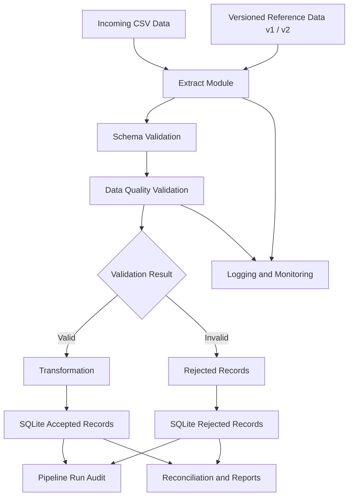

# Reference Data Validation Pipeline

## 1. Project Overview

The Reference Data Validation Pipeline is a Python-based data engineering project designed to validate incoming event data against versioned reference datasets, transform valid records, and load accepted and rejected records into a SQLite database.

The pipeline handles effective dates, unknown reference codes, deprecated codes, duplicate records, schema validation, and reference-data updates.

It also provides audit logging, retry handling, record-level traceability, automated testing, and performance benchmarking.

## 2. Key Features

- CSV data extraction using Pandas.
- Versioned reference data management.
- Schema validation and unexpected column detection.
- Missing required field detection.
- Duplicate event ID detection.
- Unknown reference code identification.
- Effective date validation.
- Historical deprecated code validation with warnings.
- Data transformation and enrichment.
- Accepted and rejected record separation.
- SQLite database integration.
- Idempotent data loading to prevent duplicate accepted and rejected records.
- Retry handling and failure auditing.
- Source row-level traceability.
- Pipeline execution logging and metrics.
- Automated testing using Pytest.
- Performance benchmarking for large datasets.

## 3. Project Architecture

The pipeline follows a modular architecture with separate components for extraction, validation, transformation, loading, and monitoring.

### Pipeline Flow



### Project Structure

```text
Reference-Data-Validation-Pipeline/
│
├── data/
│   ├── input/
│   ├── reference/
│   └── output/
│
├── src/
│   ├── generator.py
│   ├── extract.py
│   ├── validate.py
│   ├── transform.py
│   ├── load.py
│   ├── pipeline.py
│   ├── benchmark.py
│   └── compare_reference_versions.py
│
├── tests/
│   └── test_pipeline.py
│
├── docs/
│   ├── DATA_DICTIONARY.md
│   ├── DESIGN_DECISIONS.md
│   └── RECONCILIATION_QUERIES.sql
│
├── prompts/
│   ├── AI_USAGE.md
│   └── prompt_history.md
│
├── reports/
│   ├── PROJECT_RESULTS.md
│   └── sample_transformed_output.csv
│
├── requirements.txt
├── .gitignore
└── README.md
```

### Module Responsibilities

| Module | Responsibility |
|---|---|
| generator.py | Generates reproducible synthetic input data. |
| extract.py | Reads source and reference CSV files and validates their schemas. |
| validate.py | Applies data quality and business validation rules. |
| transform.py | Enriches accepted records with reference information. |
| load.py | Loads accepted and rejected records into SQLite and maintains audit history. |
| pipeline.py | Coordinates the complete pipeline execution. |
| benchmark.py | Measures processing performance on larger datasets. |
| compare_reference_versions.py | Compares validation results across reference versions. |

## 4. Technologies Used

- Python
- Pandas
- SQLite
- Pytest
- CSV
- Git and GitHub

## 5. Data Validation Rules

The pipeline applies the following validation rules:

1. Required fields must not be empty.
2. Event IDs must be unique.
3. Duplicate event IDs are rejected.
4. Unknown reference codes are rejected.
5. Events before the reference effective date are rejected.
6. Expired reference codes are rejected.
7. Historical events using deprecated codes are accepted with a warning when they fall within the valid period.
8. Invalid event dates are rejected.
9. Duplicate reference codes cause reference validation to fail.
10. Unexpected or missing source columns cause schema validation to fail.

The `valid_to` date is treated as inclusive.

## 6. Reference Version Comparison

The project supports two reference datasets:

- Reference v1
- Reference v2

Reference v2 introduces a new reference code, PNQ (Pune).

### Comparison Results

| Metric | Reference v1 | Reference v2 |
|---|---:|---:|
| Reference records | 5 | 6 |
| Input records | 12 | 12 |
| Accepted records | 3 | 4 |
| Rejected records | 9 | 8 |

The new PNQ reference code allows event E007 to pass validation in v2.

This demonstrates how reference-data updates can change validation outcomes without modifying the pipeline logic.

## 7. Installation and Setup

### Prerequisites

- Python 3.10 or later
- pip
- Git

### Clone the Repository

```bash
git clone https://github.com/bindhuvaddevolu/Reference-Data-Validation-Pipeline.git

cd Reference-Data-Validation-Pipeline
```

### Install Dependencies

```bash
python -m pip install -r requirements.txt
```

The project dependencies are:

```text
pandas==2.3.2
pytest==9.1.1
```

## 8. Run the Pipeline

### Run Using Reference Version v1

```bash
python -m src.pipeline --reference-version v1
```

### Run Using Reference Version v2

```bash
python -m src.pipeline --reference-version v2
```

The pipeline extracts the input data, validates records, transforms accepted records, loads results into SQLite, and records execution details.

## 9. Run Automated Tests

Execute the test suite:

```bash
python -m pytest tests/ -v
```

The project currently includes **18 automated tests** covering:

- Valid records.
- Empty input.
- Missing required fields.
- Unknown reference codes.
- Expired reference codes.
- Future effective dates.
- Historical deprecated codes.
- Invalid event dates.
- Duplicate event IDs.
- Duplicate reference codes.
- Database idempotency.
- Source row number traceability.
- Retry behavior.
- Reference version audit metadata.
- Missing source columns.
- Unexpected source columns.
- Malformed CSV files.
- Out-of-order event dates.

### Latest Test Result

**18 tests passed successfully.**

Latest verified execution:

```text
18 passed in 2.95s
```

## 10. Performance Benchmark

The project supports generating and benchmarking larger synthetic datasets.

### Generate Synthetic Data

Generate the default 100,000-record dataset:

```bash
python -m src.generator --size 100000
```

The generator uses a fixed random seed (42) to support reproducibility.

### Run the Benchmark

```bash
python -m src.benchmark
```

### Latest Dataset Distribution

| Scenario | Generated Records |
|---|---:|
| Normal records | 92,000 |
| Duplicate records | 2,000 |
| Missing required fields | 2,000 |
| Invalid dates | 2,000 |
| Unknown reference codes | 2,000 |
| **Total** | **100,000** |

### Latest Benchmark Results

| Metric | Result |
|---|---:|
| Input records | 100,000 |
| Accepted records | 60,226 |
| Rejected records | 39,774 |
| Extraction time | 0.3270 seconds |
| Validation time | 1.4083 seconds |
| Transformation time | 0.1100 seconds |
| Total processing time | 1.8453 seconds |
| Throughput | 54,192.22 records/second |

**Note:** Benchmark timing covers extraction, validation, and transformation. SQLite loading time is not included in this measurement.
Note: Benchmark timings may vary depending on hardware and system conditions.

The validation stage accounts for the largest share of measured processing time.

## 11. Database and Audit

The pipeline uses SQLite to maintain three main tables:

| Table | Purpose |
|---|---|
| accepted_records | Stores successfully validated and transformed records. |
| rejected_records | Stores rejected records with their rejection reasons. |
| pipeline_runs | Stores pipeline execution history and processing metrics. |

Each pipeline execution records:

- Run ID.
- Source file.
- Reference version.
- Reference filename.
- Execution status.
- Input record count.
- Accepted record count.
- Rejected record count.
- Start and end timestamps.
- Error information when execution fails.

Source row numbers are preserved to support record-level traceability.

## 12. Reproducibility and Idempotency

The pipeline supports repeatable execution through synthetic data generation and controlled reference versions.

- Synthetic data can be generated for larger input volumes.
- Reference datasets can be selected using command-line arguments.
- Accepted records use a composite primary key of event ID and reference version.
- Duplicate accepted records are prevented during repeated loads.
- Rejected records are maintained with run-level audit information.
- Failed executions are recorded for troubleshooting.
- The generator uses a fixed random seed for reproducibility.
- Rejected records are deduplicated using source file hash, source row number, and reference version.
- Every pipeline execution is recorded separately, including reruns.

## 13. Documentation and Reports

Additional project documentation is available in the following files:

- [Data Dictionary](docs/DATA_DICTIONARY.md) – Describes source data, reference data, target tables, fields, and business rules.
- [Design Decisions](docs/DESIGN_DECISIONS.md) – Explains technology choices, architecture, implementation decisions, and trade-offs.
- [Reconciliation Queries](docs/RECONCILIATION_QUERIES.sql) – Contains SQL queries for validating database consistency and record traceability.
- [Project Results](reports/PROJECT_RESULTS.md) – Contains validation results, reference comparison, and performance measurements.
- [Sample Transformed Output](reports/sample_transformed_output.csv) – Shows representative accepted and transformed records.
- [AI Usage Disclosure](prompts/AI_USAGE.md) – Describes the use of AI assistance during project development.

## 14. Future Improvements

- Add automated pipeline scheduling.
- Integrate data quality dashboards.
- Support additional input formats.
- Add structured monitoring and alerting.
- Extend performance testing to include database loading.
- Introduce cloud-based storage and processing.
- Add automated recovery and notification mechanisms.

## 15. Author

Developed as an individual Data Engineering project.